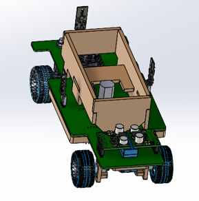
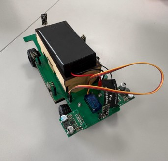
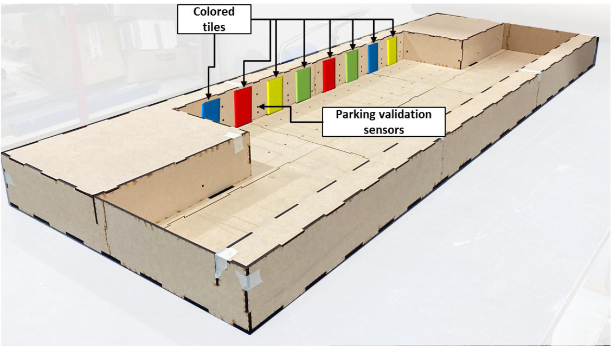
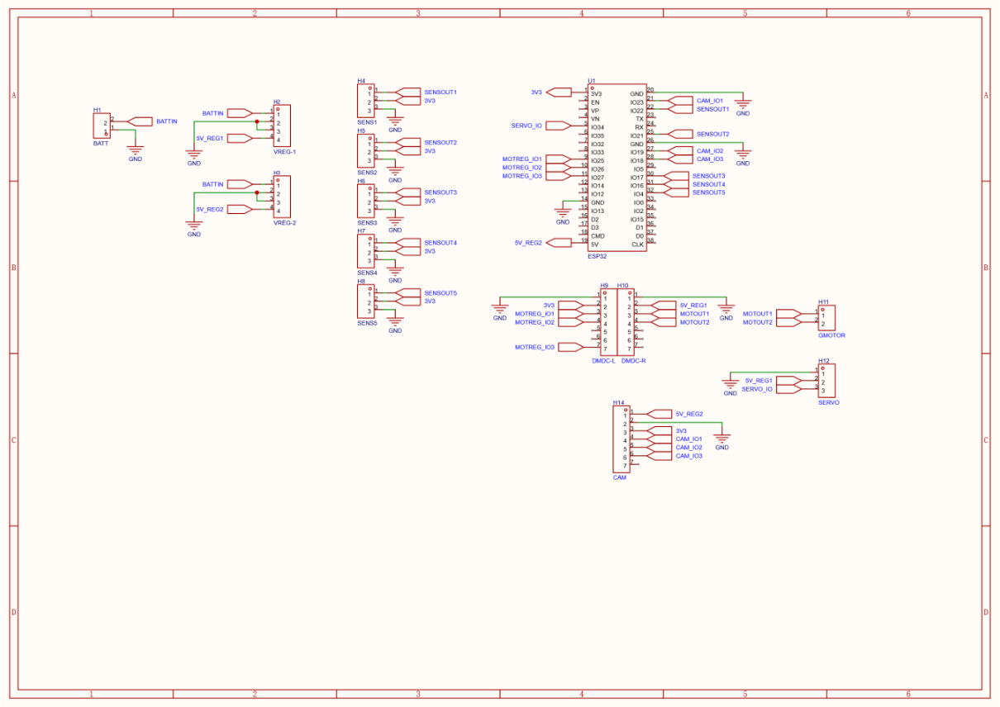
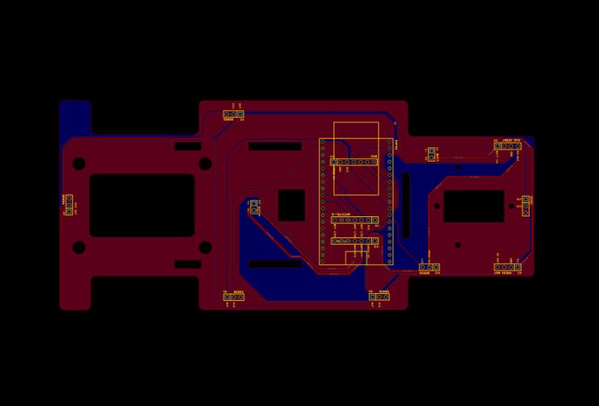
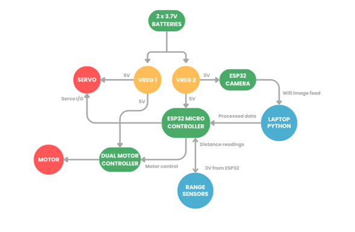
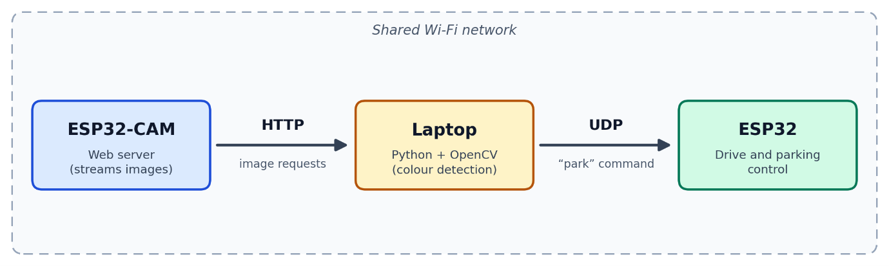

# Autonomous Self Parking Car
A model electronic car that autonomously locates and parks in a bay matching a reference-coloured tile through colour detection vision software & sensor feedback. This project was done by a team of three for this [class](https://www.waikato.ac.nz/study/papers/engee281/2026/)

## Sections Developed
- Laser cut MDF chassis designed in Solidworks CAD
- Custom breakout board PCB designed in EasyEDA
- Colour detection and system simulation software written in Python using OpenCV
- System control software written in MicroPython

## Components Used
| Component | Qty |
|---|---|
| Pololu voltage regulator (4082) | 3 |
| Pololu dual motor controller (2135) | 1 |
| Pololu range sensor (4079) | 5 |
| Gear motor | 2 |
| Micro servo (SG90) | 1 |
| ESP32-CAM | 1 |
| ESP32 DevKitC-32E | 1 |
| Lego differential assembly | 1 |
| 18650 battery holder and 2 × 18650 cells | 1 |

## Project Task Description
The task was to design a model vehicle that starts in the arena's starting area and,
after a reference tile is placed, travels along a row of bays. At each open bay it checks that
the bay is valid, then reverse-parks in the bay whose colour matches the reference tile. A bi-
coloured tile requires parking in two bays in sequence. Dummy cars occupy random bays,
tile order changes between runs, and the tiles are placed only after the SSV starts moving. If
no valid bay exists, the SSV must continue forward and stop safely in the engraved area
opposite the start.

## Images

  
  

  
  

